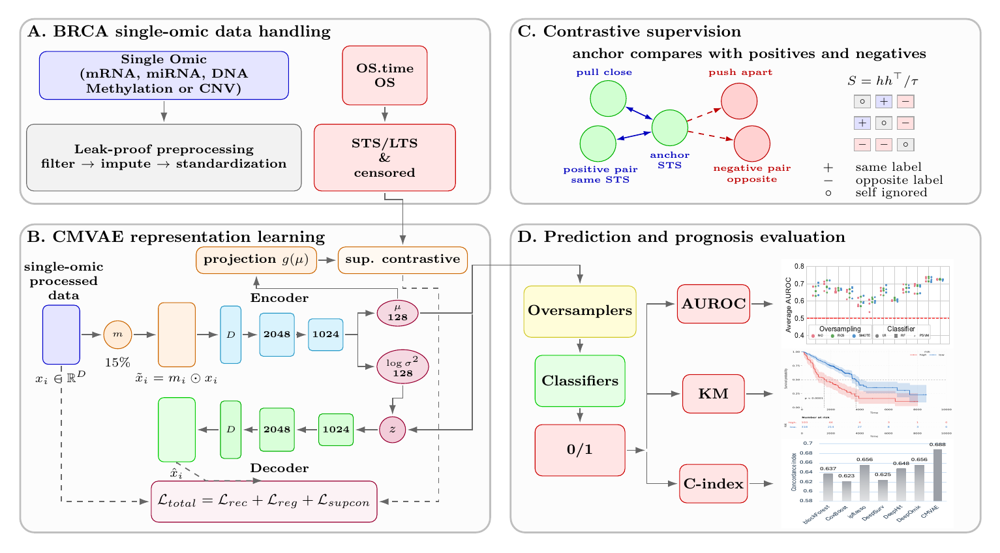

# Welcome to CMVAE!

This repository corresponds to the article titled **"CMVAE: Contrastive Supervision Improves Single-Omic Latent Manifold for Breast Cancer Survival Prognosis"** (RLPD-BIO workshop, IEEE BIBM 2026).


*Figure 1: Overview of the proposed CMVAE framework. (A) single-omic data handling and STS/LTS labeling, (B) CMVAE representation learning, (C) contrastive supervision, (D) prediction and prognosis evaluation.*

Predicting whether a breast cancer patient will be a short-term (STS, < 5 years, deceased) or long-term (LTS, >= 5 years) survivor from a single omic profile is hard because the cohorts are small and the features are high-dimensional. In this work, we developed CMVAE, a Contrastive Masked Denoising Variational Autoencoder. CMVAE randomly masks input features and reconstructs the clean profile, and it adds a supervised contrastive loss on the labeled STS/LTS patients so that the latent space reflects clinical outcome. Censored patients (follow-up < 5 years, no event) are used only for reconstruction. We evaluate CMVAE on four TCGA-BRCA omics (mRNA, DNA methylation, miRNA, and copy number variation) with a leak-proof stratified 5-fold cross-validation, and compare it against 11 other representations (Raw, PCA, Gini, AE, VAE, and MVAE variants) using logistic regression, random forest, and polynomial SVM classifiers, with and without oversampling. We report performance with AUROC and the concordance index, along with Kaplan-Meier analysis.

**Note:** The real TCGA-BRCA data is not redistributed. A synthetic dataset in the same file format is provided in `data/dummy/BRCA` so the code can run. Results on the synthetic data are only meant to show that the pipeline runs.

## Installation
```bash
git clone https://github.com/kabir-ai2bio-lab/CMVAE.git
cd CMVAE
conda create -c conda-forge -n cmvae python=3.11 -y
conda activate cmvae
pip install -r requirements.txt
```
Install the PyTorch build that matches your hardware from [pytorch.org](https://pytorch.org) if the default one does not suit you. Run all commands below from the repository root.

## Data
We obtained the data from the [UCSC Xena browser](https://xenabrowser.net/) for the TCGA-BRCA cohort.

| Data | Xena file |
| :--- | :--- |
| mRNA expression | ```TCGA.BRCA.sampleMap_HiSeqV2``` |
| DNA methylation | ```TCGA.BRCA.sampleMap_HumanMethylation450``` |
| miRNA expression | ```TCGA.BRCA.sampleMap_miRNA_HiSeq_gene``` |
| Copy number variation | ```TCGA.BRCA.sampleMap_Gistic2_CopyNumber_Gistic2_all_data_by_genes``` |
| Survival | ```survival_BRCA_survival.txt``` |

| Step  | Scripts |
| :--- | :--- |
| Generate the synthetic data (already in `data/dummy/BRCA`) | ```data/make_dummy_data.py``` |
| Download the real data into `data/BRCA` | ```data/download_xena_data.py``` |

Patients with OS time >= 1826.25 days are labeled LTS (0). Patients with OS time < 1826.25 days and an observed death are labeled STS (1). The remaining patients are censored and excluded from the classifier and the contrastive loss.

## Exploratory data analysis
```bash
python EDA/label_distribution.py --data_dir data/dummy/BRCA
```

## Training and testing CMVAE
The entry point is `run_cmvae.py`. Preprocessing (missing-rate filter, imputation, top-variance selection, and z-scoring), representation learning, oversampling, and classifier fitting are all done inside the training part of each cross-validation fold.

```bash
# quick test (5 epochs)
python run_cmvae.py --omic mRNA --data_dir data/dummy/BRCA --quick

# full run for all four omics
python run_cmvae.py --omic all --data_dir data/dummy/BRCA
```

| Module | Usage |
| :--- | :--- |
| ```CMVAE.model``` | MaskedDenoisingVAE and CMVAE (VAE with projection head) |
| ```CMVAE.train_val``` | VAE training loop and 5-fold cross-validation |
| ```CMVAE.losses``` | Reconstruction, KL, MMD and supervised contrastive losses |
| ```CMVAE.preprocessing``` | Fold-specific feature filtering, imputation and scaling |
| ```CMVAE.data``` | Data loading, labeling and patient folds |
| ```CMVAE.evaluation``` | Classifiers (LR, RF, PSVM), oversampling (NO, ROS, SMOTE) and metrics |
| ```CMVAE.configs``` | All hyper-parameters |

Main settings: latent dimension 128, masking ratio 0.15, contrastive weight 0.1, temperature 0.2, KL weight up to 0.01, MMD weight up to 1.0, 20 warm-up epochs, five-year threshold 1826.25 days, seed 42 and 5 folds. Omic-specific settings:

| Omic | Missing-rate filter | Top-variance features | Epochs | Batch size |
| :--- | :--- | :--- | :--- | :--- |
| mRNA | > 90% | 2000 | 80 | 64 |
| DNA methylation | > 10% | 5000 | 80 | 64 |
| miRNA | > 20% | 500 | 150 | 32 |
| CNV | > 20% | 2000 | 80 | 64 |

## Benchmark methods
All benchmark methods use the same patients, labels, and folds as CMVAE. The MAE folder is the masked denoising VAE without the contrastive term.

| Method | Run |
| :--- | :--- |
| Raw (top-500 variance), PCA, Gini | ```python -m benchmark_eval.classical.run_classical --omic all --method all --data_dir data/dummy/BRCA``` |
| AE | ```python -m benchmark_eval.AE.train_val --omic all --data_dir data/dummy/BRCA``` |
| VAE (MSE/Logcosh x KL/MMD) | ```python -m benchmark_eval.VAE.train_val --omic all --data_dir data/dummy/BRCA``` |
| MAE (MVAE) | ```python -m benchmark_eval.MAE.train_val --omic all --data_dir data/dummy/BRCA``` |

## Analysis and plotting

| Output | Script |
| :--- | :--- |
| Benchmark comparison of the 12 methods and CMVAE heat map | ```python analysis_plotting/plot_benchmark_comparison.py``` |
| Kaplan-Meier, log-rank test and C-index with bootstrap confidence interval | ```python analysis_plotting/survival_analysis.py --omic mRNA``` |
| C-index comparison with other multi-omics methods | ```python analysis_plotting/plot_cindex_comparison.py``` |
| Training and validation loss curves | ```python analysis_plotting/plot_loss_curves.py --omic mRNA --method CMVAE``` |

All results are written to `outputs/<omic>/` (change with `--out_dir`):

```
outputs/<omic>/
    folds/fold_indices.json              patient barcodes of each fold
    <Method>/results/per_fold_results.csv
    <Method>/results/display_summary.csv
    <Method>/results/loss_curves.csv
    CMVAE/models/                        trained models
    analysis/                            figures and tables
```

## Reproducing with the real data
```bash
python data/download_xena_data.py
python run_cmvae.py --omic all --data_dir data/BRCA
```

## Authors

* [Akash Singh](mailto:akashsingh@usf.edu)
* [Anowarul Kabir](mailto:akabir@usf.edu)

## How to cite CMVAE?
The final bibliographic citation is not available in this repository yet.

## License

This program is Open-Source under the MIT License. See [LICENSE](LICENSE).
